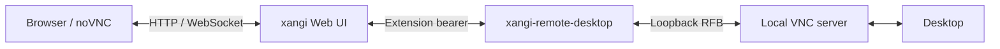

[日本語](README.md) | English

# xangi-remote-desktop

An xangi extension for viewing and controlling the desktop of the PC running xangi from a browser. It uses noVNC and connects to a VNC server on the same PC.

## Features

- Desktop access through the existing xangi HTTP/WebSocket port
- Mouse and keyboard input, input toggle, disconnect and manual reconnect
- Fit-to-window and fullscreen where supported
- Input initially disabled; optional server-side saved VNC password and browser registration

## Architecture



## Quickstart

Requires Node.js 22+, xangi with managed HTTP/WebSocket extensions, and a VNC server on the same PC. The initial launcher targets Linux/macOS. Native Windows extension startup and platform validation limitations are listed in the [usage guide](docs/en/usage.md).

```sh
npm ci
npm run build
# First setup only; do not overwrite an existing .env.
cp .env.example .env
```

Set `REMOTE_DESKTOP_VNC_PORT` in `.env`, then follow [setup and registration](XANGI_SETUP.md). With an empty port, desktop connections remain disabled. No paid service is required. VNC servers are not bundled and OS sharing settings are never enabled automatically.

From the extension directory, use `npm run setup` to validate saved-auth settings and display the registration code, `npm run registration -- show` to display it again, and `npm run registration -- rotate` to reissue it. Stop/start the extension after rotation. See [setup](XANGI_SETUP.md).

## Documentation

- [Setup and extension registration (Japanese)](XANGI_SETUP.md)
- [Usage, configuration and platform status](docs/en/usage.md)
- [Architecture and design decisions](docs/en/design.md)

## Development

```sh
npm ci
npm run build
npm run check
npm test
```

The build preserves unmodified noVNC source and license notices in `dist/`. The viewer links to these files. The initial version permits one viewer at a time.

## License

[MIT](LICENSE)
