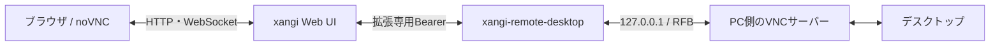

日本語 | [English](README.en.md)

# xangi-remote-desktop

xangiが動くPCの画面をブラウザから閲覧・操作する拡張です。noVNCを利用し、同じPCのVNCサーバーへ接続します。

## 主な機能

- xangiの拡張画面から、同じポートでデスクトップへ接続
- マウス・キーボード操作、入力の開始／停止、切断・手動再接続
- 画面サイズに合わせた表示、全画面表示（対応ブラウザ）
- 接続は初期状態で入力停止。任意でPC側の保存パスワードとブラウザ登録による自動認証

## アーキテクチャ



## Quickstart

初版はLinux／macOSのmanaged extension起動に対応する構成です。Node.js 22以上と、同じPCで動くVNCサーバーが必要です。Windowsのネイティブ拡張起動と各OSの実機対応状況は[使い方](docs/usage.md#対応状況)を確認してください。

```sh
npm ci
npm run build
# 初回のみ。既存の.envは上書きしないでください。
cp .env.example .env
```

`.env`の`REMOTE_DESKTOP_VNC_PORT`に準備したVNCサーバーのポートを設定し、[セットアップ](XANGI_SETUP.md)に従ってxangiへ登録します。初期状態では接続先を設定していないため、画面共有は始まりません。

追加の有料サービスは使用しません。VNCサーバーは同梱せず、OSの画面共有設定も自動変更しません。

登録コードは拡張のディレクトリで`npm run setup`（初回設定の確認・表示）、`npm run registration -- show`（再表示）、`npm run registration -- rotate`（再発行）で管理できます。再発行後は拡張の停止・起動が必要です。詳細は[セットアップ](XANGI_SETUP.md)。

## ドキュメント

- [セットアップ・拡張登録](XANGI_SETUP.md)
- [使い方・設定・対応状況](docs/usage.md)
- [構成・認証・設計判断](docs/design.md)
- [English usage](docs/en/usage.md) / [English design](docs/en/design.md)

## 開発

```sh
npm ci
npm run build
npm run check
npm test
```

`build`はnoVNCの改変していないソースと著作権・ライセンス表示を`dist/`へコピーします。画面の「ライセンスとソース」から閲覧できます。初版は接続中の1クライアントに限定します。

## License

[MIT](LICENSE)
